# CANChat end-to-end observability & logging suite (v2)

> **v2 revises [v1](Canchat-v2-Logging%20Architecture-v1.md)** after a review against the source code. This is a proposed architecture, not a description of implemented controls. See [Changes from v1](#changes-from-v1) and [Implementation gates](#implementation-gates).
>
> **v2.1 (2026-10-02):** claims re-verified against source. Adds the existing `message_metrics` usage-analytics path, the CrewAI shared-token defect, corrected CSP/RAG/dependency notes, an explicit log record contract and configuration reference (§12), demotes Faro from *required* to *planned*, and moves the §11 hold/disposition workflow to a separate records-management design. See rows 19–22 in [Changes from v1](#changes-from-v1).

## Context

CANChat already has pieces of an observability stack, but they aren't connected:

- **Metrics only, and mostly unused.** [instrumentation.py](../backend/open_webui/instrumentation.py) sets up an OTel `MeterProvider` that sends OTLP/HTTP data to the collector at [otel-collector-config.yaml](../otel-collector-config.yaml), and Prometheus reads from the collector ([prometheus-config.yaml](../prometheus-config.yaml), [docker-compose.qdrant.yaml](../docker-compose.qdrant.yaml)). `MetricsService` ([metrics/service.py](../backend/open_webui/metrics/service.py)) builds `http_requests_total`, `http_request_duration_ms` and `task_queue_size` from `METRIC_DEFINITIONS` ([config.py:824](../backend/open_webui/config.py#L824)), but **nothing ever records them**. `get_metrics()` ([utils/metrics.py](../backend/open_webui/utils/metrics.py)) has no callers. The only live OTel metrics are in [web_search_logger.py](../backend/open_webui/retrieval/web/web_search_logger.py).
  - **Bug:** if the `METRIC_DEFINITIONS` env var is set, `os.environ.get` returns a *string*, and `MetricsService` fails while iterating over it. The value has to be parsed with `json.loads`.
  - The exporter defaults to `http://localhost:4318/v1/metrics`, with a configurable endpoint and a default 5-second export interval. There is currently no explicit enable/disable switch; an unavailable collector can produce export errors.
- **No traces and no log pipeline.** Logs are plain text on stdout. `logging.basicConfig` is called in **13 modules** (11 in-process, 2 standalone scripts): [env.py:73](../backend/open_webui/env.py#L73) (the only `force=True` call), [main.py:334](../backend/open_webui/main.py#L334), [functions.py](../backend/open_webui/functions.py#L37), [socket/main.py](../backend/open_webui/socket/main.py#L24), [utils/middleware.py](../backend/open_webui/utils/middleware.py#L87), [utils/chat.py](../backend/open_webui/utils/chat.py#L45), [utils/models.py](../backend/open_webui/utils/models.py#L25), [retrieval/loaders/main.py](../backend/open_webui/retrieval/loaders/main.py#L32), three in `mcp_backend/` ([crew_mcp_integration.py](../backend/mcp_backend/integration/crew_mcp_integration.py#L22), [fastmcp_news_server.py](../backend/mcp_backend/servers/fastmcp_news_server.py#L17), [generic_sharepoint_server_multi_dept.py](../backend/mcp_backend/servers/generic_sharepoint_server_multi_dept.py#L1946)), and the standalone scripts [k8s_vector_cleanup.py](../backend/scripts/k8s_vector_cleanup.py#L20) and [fast_cronjob_simulator.py](../backend/scripts/fast_cronjob_simulator.py#L83). Each subsystem sets its own level through `SRC_LOG_LEVELS`. No `opentelemetry.trace` import exists anywhere in the backend, and [requirements.txt](../backend/requirements.txt#L136) pins only `opentelemetry-api`, `-sdk` and `-exporter-otlp` (1.42.0); no instrumentors or logging bridge are installed.
- **Correlation is partial.** [custom_logging.py](../backend/open_webui/custom_logging.py) enriches the access log using contextvars (user ID, request_id, duration). However:
  - it only *reads* `X-Request-Id`. It never generates the ID, returns it to the client, or passes it on to outbound calls, so most lines show `request_id=N/A`;
  - it is a `BaseHTTPMiddleware`, which has known problems with streaming responses and contextvars. Its duration stops when the response *headers* are sent, so streamed `/ollama` and `/openai` responses are under-reported.
- **Chat has several execution paths.** [chat_completion](../backend/open_webui/main.py#L1210) processes the payload and awaits `chat_completion_handler` before calling `process_chat_response`. The [OpenAI provider](../backend/open_webui/routers/openai.py#L689) opens the upstream request at this stage. For a streaming response with session/chat/message metadata, [process_chat_response](../backend/open_webui/utils/middleware.py#L1624) starts a background task to consume the already-open stream and returns `{status, task_id}`. Without that metadata it can return a direct HTTP stream; non-streaming responses are handled synchronously. HTTP latency is not a substitute for full generation latency.
- **CrewAI uses a separate path.** Tool-enabled chats can call [queryCrewMCPWebSocket](../src/lib/components/chat/Chat.svelte#L1431), bypassing `/api/chat/completions`. The [socket handler](../backend/open_webui/socket/main.py#L403) executes the crew through [`run_in_executor`](../backend/open_webui/socket/main.py#L537). Unlike `asyncio.create_task`, that executor call does not automatically copy contextvars.
  - **Defect:** the handler stores the caller's Graph token with [`crew_mcp_manager.set_user_token(...)`](../backend/open_webui/socket/main.py#L500-L512), which is **process-global mutable state**. Two concurrent CrewAI requests can run the second user's crew with the first user's token (or `None`). Beyond the authorization problem, this means no CrewAI audit event can claim a trustworthy actor until the token is passed per invocation.
- **Server-side usage analytics already exists.** The [`message_metrics`](../backend/open_webui/models/message_metrics.py#L14-L29) table records `user_id`, `user_domain`, `model`, prompt/completion/total tokens, `chat_id` and `mcp_tool` per message. It is written from the HTTP chat path ([middleware.py:1832](../backend/open_webui/utils/middleware.py#L1832), [:1931](../backend/open_webui/utils/middleware.py#L1931), [:2148](../backend/open_webui/utils/middleware.py#L2148)) and the CrewAI socket path ([socket/main.py:571](../backend/open_webui/socket/main.py#L571)), served by [routers/metrics.py](../backend/open_webui/routers/metrics.py) for the admin dashboard, and `export_logs` records exports of it. This overlaps with the proposed `category=chat` metadata audit event, `llm_tokens_total`, and the Analytics org; the plan must build on it rather than create a parallel token-count source (see [§5](#5-audit-events-emit_audit_event-metadata-only)).
- **Socket business events are not instrumented.** ASGI instrumentation can observe websocket transport activity, but does not provide the per-event, per-generation context required for Socket.IO and CrewAI workflows.
- **Audit logging is one-off.** [web_search_logger.py](../backend/open_webui/retrieval/web/web_search_logger.py) emits structured records and OTel metrics. Its INFO dispatch record sets query/email/name to `None`; sensitive values are emitted separately at DEBUG, as [existing tests](../backend/open_webui/test/apps/webui/retrieval/test_web_search_logging.py#L104) confirm. Other security events need a consistent audit schema and durable delivery. `export_logs` is an existing database record, not a centralized security audit pipeline.
- **Sensitive logging already exists upstream of the collector.** [socket/main.py:434](../backend/open_webui/socket/main.py#L434) logs the first 100 characters of the prompt at INFO, and [socket/main.py:481](../backend/open_webui/socket/main.py#L481) logs the first 50 characters of the user's Graph access token at INFO. Changing format or filtering in the collector does not remove these from stdout. Source-side removal and filtering are prerequisites for broader collection.
- **The frontend is blind.** [hooks.client.ts](../src/hooks.client.ts) only installs the auth fetch interceptor ([apis/client.ts](../src/lib/apis/client.ts)). It doesn't capture client errors or send correlation headers.
- **MCP built-in servers run over stdio** as subprocesses. Trace context does not cross that boundary.
- There are about **131 `print()` calls** in backend code (tests excluded), and they skip log levels and formatting.

**Goal:** a single OTel-based suite covering logs, traces and metrics, built on the existing pieces. It will have:
- W3C trace context plus a validated request/operation ID across HTTP, Socket.IO, tasks and executor work, with explicit boundaries where downstream instrumentation is unavailable;
- structured JSON logs without credentials, prompt/response text, email or names in the operational stream; restricted user IDs remain linkable identifiers, not anonymous data;
- a generic audit-event API (metadata only);
- **optional, off-by-default content auditing**, with a lifecycle based on record purpose and chat activity rather than a blanket log TTL (see [§8](#8-content-audit-off-by-default));
- a self-hosted Grafana stack that needs no public-cloud telemetry service at runtime, with separate Operations, Audit and aggregate-only Analytics orgs;
- **web frontend observability and analytics with Grafana Faro** (planned, phase 6): errors, web vitals, browser traces, page views, sessions and feature-usage events, stored in the same self-hosted stack (see [§10](#10-frontend-observability-and-analytics-grafana-faro)). When adopted, Faro is the single frontend telemetry path; it is not a prerequisite for the backend phases.

## Products at a glance

| Product | Role | What it logs / does | Status |
|---|---|---|---|
| **OpenTelemetry Python SDK** | In-app instrumentation | Produces metrics, spans and log records inside FastAPI and sends them over OTLP/HTTP. Auto-instruments FastAPI, aiohttp, requests, SQLAlchemy and Redis. | Existing (metrics only), extended to traces and logs |
| **`FastAPIInstrumentor`** | HTTP server telemetry | Server spans and HTTP metrics, explicitly opting into stable HTTP semantic conventions. `http.server.request.duration` is in seconds; route templates bound cardinality. Replaces the hand-made `http_*` metrics. | New |
| **Python `logging`** (JSON formatter) | App logs | Structured JSON on stdout following the log record contract in §1, with `request_id`, `operation_id`, `trace_id`, `span_id`, `user_id` and `logger`. Levels are set per subsystem through `SRC_LOG_LEVELS`. | Existing (text), changed to JSON |
| **`RequestContextMiddleware`** (pure ASGI) | Correlation and access log | Validates or generates `X-Request-Id`, echoes it back, sets the contextvars, and measures duration up to the **last body chunk**. Replaces `LoggingMiddleware`. | Rewrite of existing |
| **`MetricsService`** | Domain-metric registry | Counters, histograms and gauges for LLM, RAG, MCP, socket, task queue and audit. HTTP metrics come from `FastAPIInstrumentor` instead. | Existing, fixed and now actually recorded |
| **`audit.py` and delivery worker** | Durable security audit | Metadata-only events with stable event IDs, a persistent outbox and delivery tracking to the approved SIEM/evidence archive. Loki is the searchable copy. | New |
| **`content_audit.py`** | Restricted content audit | Optional prompt/response capture with separate storage, access and lifecycle controls. An audited export of existing chats is the baseline alternative. No operational logger or stdout propagation. | New, off by default; §8 gate |
| **`web_search_logger.py`** | Web search audit | Preserve INFO sanitization and metrics; remove or isolate sensitive DEBUG emission before sharing helpers. | Existing, refactored |
| **SvelteKit client hooks** | Correlation and Faro bootstrap | Adds `X-Request-Id` to internal API calls. Initializes Faro from runtime config and sets the view on every navigation. | New |
| **Grafana Faro Web SDK** (`@grafana/faro-web-sdk` + `@grafana/faro-web-tracing`) | Browser observability **and** web analytics | Errors and unhandled rejections, web vitals, fetch/navigation timings, browser spans with `traceparent`, page views (by route ID), sessions and an allow-listed set of feature-usage events. Bundled with the app (no CDN), so it works offline. | New, **planned (phase 6)** |
| **Grafana Alloy** (`faro.receiver`) | Browser telemetry ingestion | Receives same-origin Faro payloads. Logs pass through `otelcol.receiver.loki` before OTLP export; traces use OTel consumers directly. Applies trusted frontend identity and validation. | New, with Faro (phase 6) |
| **OTel Collector** (contrib, pinned) | Telemetry gateway | Authenticated OTLP ingestion, bounded queues, filtering and routing by trusted ingestion class. Collector redaction supplements source filtering. | Existing (metrics only), extended |
| **Prometheus** (pinned) | Operational and analytics metrics | Operational metrics remain separate from an aggregate-only analytics instance. Approved windowed counts and distributions support reporting without granting access to raw logs. | Existing operational store; new analytics store |
| **Loki 3.x** | Searchable log store | Native OTLP ingestion into `app`, `frontend` and `audit` tenants, behind a tenant-enforcing proxy. Separate authoritative evidence/content repositories handle preservation clocks and holds; a content search copy is not part of the baseline. See §11. | New |
| **Tempo** | Trace store | Browser, HTTP, websocket-operation, generation and dependency-client spans, linked to logs through `trace_id`. | New |
| **Grafana** (OSS) | Visualization & alerting | Operations has operational data; Audit has restricted audit sources; Analytics has only an isolated aggregate metrics source. Viewer permissions alone do not restrict raw-data queries. | New |
| **Approved SIEM / evidence archive** | Authoritative audit preservation | Durable delivery receipts, immutable evidence where required, case holds and scheduled disposition, separate from Loki's live index storage. | Integrate with SSC services |
| **`message_metrics` + `routers/metrics.py`** | Existing server-side usage analytics | Per-message user/domain/model/token/chat/MCP-tool rows and the admin metrics API. Becomes the single write point for chat-metadata audit (see §5) and the authoritative cross-check for browser analytics (§10). | Existing, extended |
| **Postgres / Redis / Qdrant / Ollama** | Observed dependencies | Client spans show calls from CANChat. Internal database/model-server spans and service-health metrics require their own instrumentation/exporters. Qdrant is the only vector store present and has no OTel instrumentor. | Existing |

## System diagram

```mermaid
flowchart LR
  subgraph Browser["Browser (SvelteKit)"]
    FE["Faro + fetch interceptor<br/>errors / vitals / usage events"]
    SIO_C["Socket.IO client<br/>per-operation context carrier"]
  end
  subgraph App["open-webui (FastAPI / uvicorn)"]
    HTTP["HTTP instrumentation + pure ASGI context<br/>completion access log"]
    CHAT["Payload / RAG / provider invocation"]
    CONSUMER["Response consumption<br/>background Socket.IO / HTTP stream / JSON"]
    SOCK["Socket.IO event handlers"]
    CREW["CrewAI executor<br/>explicit context copy"]
    MCP["MCP tool boundary"]
    MM[("message_metrics<br/>single chat-metadata write point")]
    OUTBOX[("Persistent audit outbox")]
    WORKER["Audit delivery worker"]
    LOG["Source-filtered app logs / spans / metrics"]
  end
  subgraph Deps["Dependencies"]
    LLM["LLM providers"]
    DATA["DB / Redis / vector DB / web search"]
  end
  subgraph Alloy["Grafana Alloy (phase 6, with Faro)"]
    FARORX["faro.receiver<br/>limits + schema validation"]
    BRIDGE["otelcol.receiver.loki<br/>parse logs / map fields"]
    FEOTLP["OTLP export<br/>trusted frontend identity"]
  end
  COL["OTel Collector<br/>separate trusted ingress classes<br/>filter / queue / route"]
  subgraph Store["Storage"]
    LOKI["Tenant-enforcing proxy + Loki<br/>app / frontend / audit"]
    TEMPO["Tempo"]
    PROM["Operational Prometheus"]
    AGG["Approved aggregation rules / jobs"]
    ANALYTICS["Aggregate-only Prometheus"]
    EVIDENCE["SSC SIEM + separate evidence archive<br/>holds / retention clocks / disposition"]
    CONTENT["Optional restricted content repository<br/>chat-activity lifecycle; not a blanket Loki TTL"]
  end
  subgraph Grafana["Grafana OSS"]
    GOPS["Org: Operations"]
    GAUD["Org: Audit (restricted)"]
    GANA["Org: Analytics (aggregates only)"]
  end
  FE -- "HTTP + traceparent + X-Request-Id" --> HTTP
  FE -- "/faro/collect via ingress" --> FARORX
  SIO_C <--> SOCK
  HTTP --> CHAT
  CHAT --> LLM & DATA
  CHAT -- "already-open response" --> CONSUMER
  CONSUMER --> SOCK
  SOCK --> CREW
  CREW --> LLM & MCP
  CONSUMER & CREW -- "same transaction" --> MM
  MM --> OUTBOX
  CHAT --> OUTBOX
  OUTBOX --> WORKER
  WORKER --> EVIDENCE
  WORKER -- "search copy" --> COL
  CONSUMER -. "only if enabled" .-> CONTENT
  FARORX -- "Loki-format logs" --> BRIDGE
  BRIDGE --> FEOTLP
  FARORX -- "OTel traces" --> FEOTLP
  FEOTLP --> COL
  LOG --> COL
  LOG -- "filtered app logs only" --> STDOUT["stdout"]
  COL --> LOKI & TEMPO
  COL -- "scrape endpoint" --> PROM
  LOKI -- "frontend data" --> AGG
  AGG --> ANALYTICS
  LOKI -- "app / frontend" --> GOPS
  TEMPO & PROM --> GOPS
  LOKI -- "audit only" --> GAUD
  EVIDENCE & CONTENT --> GAUD
  ANALYTICS --> GANA
  MM -- "admin dashboard / cross-check" --> GANA
```



### Chat request lifecycle (what gets emitted)

The HTTP request and generation have **overlapping lifetimes**. Start `llm.chat` immediately before the provider call, not inside the later stream-consumer task. Keep an explicit operation context containing the span, monotonic start time, IDs and completion state; transfer responsibility for finalizing it to the response consumer. The operation ends exactly once, including provider errors, cancellation and stream failures. A server-child span may outlive its HTTP parent; a new, unrelated linked trace is not required for this in-process handoff.

Payload/RAG work precedes provider invocation and has separate spans. Measure total chat latency separately from provider latency. Title/tag generation and retries are distinct operations, not extra completions for the original message.

```mermaid
sequenceDiagram
  participant B as Browser
  participant M as RequestContext + FastAPIInstrumentor
  participant C as chat_completion
  participant T as Response consumer
  participant R as RAG / web search
  participant L as LLM (aiohttp)
  participant S as socket.io
  participant A as audit / content_audit
  B->>M: POST /api/chat/completions (traceparent, X-Request-Id)
  M->>M: server span, request_id + user_id contextvars
  M->>C: call app
  C->>C: span chat.process_payload (model, chat_id, features)
  C->>R: span rag.retrieve / web_search.dispatch
  R-->>C: docs (count, latency metric)
  C->>A: prompt metadata; optional restricted content capture
  C->>C: start llm.chat and provider timer
  C->>L: await chat_completion_handler (client span)
  L-->>C: open stream or complete JSON response
  alt Streaming with session/chat/message metadata
    C->>T: create_task consuming open stream + operation context
    C-->>M: status + task_id
    M-->>B: 200 + X-Request-Id (HTTP request ends)
    L-->>T: consume chunks; observe first content token
    T->>S: emit chunks (no per-token spans)
    S-->>B: tokens and completion
    T->>A: finalize operation metrics and response audit
  else Direct HTTP streaming
    C-->>M: wrapped StreamingResponse
    L-->>M: consume stream under operation context
    M-->>B: stream chunks
    M->>A: finalize operation at stream end/error/cancellation
  else Non-streaming
    C->>A: finalize operation metrics and response audit
    C-->>M: JSON response
    M-->>B: response + X-Request-Id
  end
```

**CrewAI lifecycle:** browser operation context -> `crew-mcp-query` -> authenticated socket handler -> executor with an explicit context copy -> crew/model/tool spans -> socket result/error. It has its own timer and audit finalization. Neither a long-lived socket connection nor `user_id` alone uniquely identifies a generation.

## Recommended approach

### 1. New `backend/open_webui/observability/` package

| Module | What it does | Built from |
|---|---|---|
| `__init__.py` | Initialize once per process, before application instruments are created. Logging remains configured when operational OTel is disabled. | Keep `instrumentation.py` as a compatibility shim exporting `meter`; avoid circular imports through config/env. |
| `providers.py` | Meter, tracer and log providers share service/version/environment resources. Initialize and flush/shut down in a defined lifecycle. Use the pinned SDK APIs and stable HTTP conventions. | Settings in [§12](#12-configuration-reference); retain existing `INSTRUMENTATION_*` aliases with explicit precedence. |
| `logging_config.py` | A shared structured formatter and source-side filters for stdout and OTLP; correlation fields on each handler. `SRC_LOG_LEVELS` remain. Audit/content loggers do not propagate to root handlers. | Centralize in-process configuration, including the `force=True` call in env. Ordinary `basicConfig` calls do not override existing handlers; standalone MCP subprocess entrypoints still need their own logging bootstrap. |
| `context.py` | Request and operation context, validated IDs, task/crew handoff and context reset. Own generation finalization independently of request lifetime. | Contextvars moved out of `custom_logging.py`; use resolved authenticated identities, not client-supplied user attributes. |
| `middleware.py` | `RequestContextMiddleware`, a **pure ASGI** middleware (see §2). | Replaces `LoggingMiddleware` |
| `tracing.py` | Instrument FastAPI, aiohttp, requests, SQLAlchemy and Redis, plus explicit generation, RAG, MCP and crew spans. Add other client instrumentation only where verified in the actual call path. | Disable noisy per-chunk ASGI send/receive spans where supported. Allow-list attributes and propagation destinations; never capture prompts, credentials or SQL parameter values. |
| `audit.py` | `emit_audit_event(...)` validates a versioned metadata schema and persists an event with a unique ID before asynchronous delivery. A logger call is not the durable record. | Reuse serialization patterns, not the existing best-effort delivery contract. New database outbox and transaction integration are required. |
| `content_audit.py` | Optional `record_prompt(...)` / `record_response(...)` use a restricted, lifecycle-aware repository. Never fall back to stdout, app logs or span attributes. | `ENABLE_CONTENT_AUDIT=false` by default; explicit size limits and truncation markers. See §8 before enabling. |

**Log record contract.** Every operational log line (stdout and OTLP) is one JSON object with the fields below. Names follow OTel log semantic conventions where one exists so Loki queries work the same for backend and (later) Faro records.

| Field | Type | Source | Notes |
|---|---|---|---|
| `timestamp` | RFC 3339 UTC, ms precision | formatter | |
| `severity_text` / `severity_number` | string / int | `record.levelname` / mapped | OTel severity numbers (INFO=9, WARN=13, ERROR=17) |
| `body` | string | `record.getMessage()` | After source filters; never raw prompt/response/credential text |
| `logger` | string | `record.name` | e.g. `open_webui.socket`, `uvicorn.access` |
| `service.name`, `service.version`, `deployment.environment` | string | resource | Same values as spans/metrics |
| `trace_id`, `span_id`, `trace_flags` | hex string | current span, if any | Empty when no span is active (startup, scheduler) |
| `request_id` | string | `context.py` | Validated or generated `X-Request-Id`; empty outside a request |
| `operation_id` | string | `context.py` | Generation / crew / socket-event ID; outlives `request_id` |
| `user_id` | string | resolved auth context | Internal ID only; never email or name |
| `chat_id`, `message_id`, `model`, `provider` | string | operation context | Structured metadata, **not** Loki index labels |
| `event` | string | caller, optional | Stable snake_case event name for machine queries, e.g. `llm.first_token` |
| `exception.type`, `exception.message`, `exception.stacktrace` | string | `record.exc_info` | `exception.message` passes through the same source filters as `body` |
| `source` | string | `record.module`:`record.lineno` | Debug aid; omitted at INFO in production if volume requires |

Logger policy:
- Root handler: JSON to stdout (`LOG_FORMAT=json`) or the current text format for local development (`LOG_FORMAT=text`). When `OTEL_ENABLED=true`, a second handler exports through the SDK `LoggingHandler`; both handlers share the same filter chain.
- `uvicorn.access`: handlers removed (as today); the completion access record is emitted by `RequestContextMiddleware` under `open_webui.access` with the fields above plus `http.request.method`, `http.route`, `http.response.status_code`, `http.response.body.size`, `duration_ms`, `client.address` (operational tenant only; see §10 Privacy for the analytics dataset).
- `uvicorn.error`, `sqlalchemy.engine`, `aiohttp`, `httpx`, `litellm`, `crewai`, `mcp`: level pinned to WARNING unless an explicit `SRC_LOG_LEVELS` entry raises it; SQL statements are never logged with bound parameters.
- `open_webui.audit` and `open_webui.audit.content`: `propagate=False`; handlers are attached only by the audit delivery path / restricted repository.
- Volume bounds: no per-token or per-chunk INFO lines; a per-logger token-bucket filter (default 100 lines / 10 s per logger per process) drops bursts and emits one summary line, so a tight exception loop cannot fill the log pipeline.

### 2. Replace `LoggingMiddleware` with a pure ASGI `RequestContextMiddleware`
- Pass non-`http` scopes (`websocket`, `lifespan`) straight through. Socket.IO/engine.io is mounted on the same ASGI app; wrapping its websocket scope would break upgrades and long-poll fallbacks. Socket event context is handled separately in §4.
- Keep the existing `/health` exclusion ([custom_logging.py `EndpointFilter`](../backend/open_webui/custom_logging.py#L62)) for the completion access record; health probes still get a server span only if `OTEL_TRACES_HEALTHCHECKS=true`.
- Read `X-Request-Id`. Accept it only if it matches `^[A-Za-z0-9._-]{8,64}$`; otherwise generate a `uuid4`. This prevents injecting content into logs. Set the contextvar and add the ID to the response headers in the `http.response.start` message.
- Measure duration up to the final `http.response.body` message (`more_body=False`), so streamed responses are timed correctly.
- Treat supplied IDs as correlation hints, never identity or authorization. Do not forward user identifiers or baggage to external providers.
- Populate user ID from the resolved authentication context. `get_request_identity()` alone does not cover API-key users; test bearer, session and API-key paths. Set request attributes while the server span is current; verify middleware ordering.
- **Use one HTTP metric family.** For instrumentation `0.63b0`, select `OTEL_SEMCONV_STABILITY_OPT_IN=http` before initialization. Verify `http.server.request.duration` in seconds and actual Prometheus names/labels against the pinned collector. Derive request counts from the histogram count; retire the unused custom HTTP instruments.
- Emit one structured **completion** access record from the ASGI middleware. Uvicorn's normal response-start access record cannot report final stream duration; disable duplicate emission while reusing suitable formatting/filter helpers. Count body bytes, handle trailers, exceptions and disconnects, and reset contextvar tokens in `finally` without swallowing cancellation.

### 3. Fix and extend `MetricsService`
- Parse `METRIC_DEFINITIONS` with `json.loads` when it comes from the environment ([config.py:824](../backend/open_webui/config.py#L824)).
- Add `record(name, value, attrs)` for counters/histograms. Register observable-gauge callbacks when creating the instrument, or use a registry-owned callback dispatcher; do not assume the SDK exposes a public callback setter.
- Define histogram boundaries and units for long-running LLM operations. Bound model/provider/tool/event labels; never use user, session, request, chat or trace IDs as metric labels. Keep high-cardinality log fields in structured metadata rather than Loki index labels.
- Replace its `print()` calls with `log.*`.

### 4. Instrument the hot paths (manual spans + domain metrics)
- **Chat payload:** instrument `chat.process_payload`, tools, files and web search in [main.py](../backend/open_webui/main.py#L1210) and [middleware.py](../backend/open_webui/utils/middleware.py). Include a separate end-to-end chat operation duration spanning preprocessing and response delivery.
- **Provider operation:** start `llm.chat` and its timer before invocation. Finalize through all three response paths in the lifecycle diagram. Record `llm_requests_total{model,provider,outcome}`, `llm_request_duration_ms` and `llm_tokens_total{type}` once per defined operation; model retries have attempt-level spans. Non-streaming responses have no observed TTFT. For streams, measure TTFT from invocation to the first parsed content token, not the first header, SSE keepalive or task start. Define reasoning-token timing separately if needed. Missing usage is unknown, not a measured zero.
  - Token counts are already persisted by `MessageMetrics.insert_new_metrics` at the same finalization points. `llm_tokens_total` and the chat-metadata audit event must be emitted from that single call site (or a thin wrapper around it), not from a separate code path, so the OTel counter, the admin dashboard and the audit record cannot drift.
- **Provider routers:** add only approved `gen_ai.*` metadata in [openai.py](../backend/open_webui/routers/openai.py) and [ollama.py](../backend/open_webui/routers/ollama.py). Auto-instrumentation supplies dependency-client spans, not a full-generation span or internal provider visibility. Verify direct provider endpoints and function/pipeline models as well as normal chat.
- **CrewAI:** instrument [crew-mcp-query](../backend/open_webui/socket/main.py#L403) independently. **Prerequisite:** replace the global [`set_user_token`](../backend/open_webui/socket/main.py#L500-L512) with per-invocation token passing (an argument to `run_intelligent_crew`, or a contextvar captured by `contextvars.copy_context()` and run inside the executor); until then the actor on any CrewAI span or audit record is unreliable. Copy the current context explicitly into each `run_in_executor` invocation, or use an equivalent verified propagation mechanism. Cover orchestration, model invocations (CrewAI's `LLM` wraps LiteLLM; verify which HTTP client it uses before relying on auto-instrumentation), MCP tools, token usage, errors/cancellation and audit completion; do not assume instrumentation in the HTTP chat handler covers this path.
- **RAG:** add embedding and vector-query spans, latency and result-count metrics. The only vector store present is [Qdrant](../backend/open_webui/retrieval/vector/dbs/qdrant.py); no OTel instrumentor exists for `qdrant-client`, so wrap its calls in manual spans. Embeddings for Ollama and OpenAI providers use synchronous [`requests.post`](../backend/open_webui/retrieval/utils.py#L593-L616) on the event loop; the `requests` instrumentor will capture them, but the blocking call distorts latency attribution for concurrent requests until it is made async or moved to a thread.
- **MCP:** instrument [mcp_manager.call_tool](../backend/mcp_backend/management/mcp_manager.py#L443) and any crew-specific tool execution boundary. Treat stdio as an explicit propagation boundary unless a supported protocol carrier is implemented. Subprocess stderr must be filtered before forwarding; retain independent logging configuration for standalone processes.
- **Socket.IO:** create per-event context from authenticated server-side session identity and a validated operation carrier (`traceparent`, operation/request ID). A socket ID and a Faro analytics session ID are different identifiers. Explicitly carry context on replies where needed; reset after each event, handle reconnects, and avoid per-token spans. Track connections and bounded event/outcome counters.
- **Tasks:** [tasks.py](../backend/open_webui/tasks.py) exposes a process-local active-task registry, not a durable queue. Document `task_queue_size` as active local tasks or rename it before adoption; aggregate instances correctly. Test lifecycle finalization on cancellation and process shutdown.

### 5. Audit events (`emit_audit_event`), metadata only
Covers:
- auth: login success/failure, logout, token refresh failure ([routers/auths.py](../backend/open_webui/routers/auths.py), [utils/auth.py](../backend/open_webui/utils/auth.py));
- user role and group changes;
- admin config changes ([routers/configs.py](../backend/open_webui/routers/configs.py));
- model access denied (`check_model_access`);
- file upload and delete, and knowledge-base changes;
- metrics exports (next to `ExportLogs.insert_new_export_log` and the [routers/metrics.py](../backend/open_webui/routers/metrics.py) export endpoint);
- MCP server changes;
- chat interactions as **metadata only** (`category=chat`, `action=message`): user ID, chat/message IDs, model, token counts, whether files, web search, knowledge or tools were used, and outcome. This is the long-lived security record of who used CanChat and how ([§11](#11-retention-and-disposition-treasury-board)); the content itself is never in it.

**Relationship to `message_metrics`.** The chat event above is a superset of what [`message_metrics`](../backend/open_webui/models/message_metrics.py#L14-L29) already stores. Two options:
- **(a) Recommended:** keep `MessageMetrics.insert_new_metrics` as the single write point, extend the row with the missing feature flags/outcome/correlation IDs, and enqueue the audit outbox record in the same `insert_new_metrics` transaction. The admin dashboard keeps working, and there is one source of truth for token counts.
- **(b)** Create a separate audit table and leave `message_metrics` untouched for the dashboard. This doubles writes on every message and requires reconciliation tests.

Decide before PR 2, because it changes which call sites PR 2/3 instrument.

Records carry `event_id`, schema version, UTC event time, trusted actor ID, action, outcome, bounded target metadata and available correlation IDs. Never include configuration secrets, email, names or message text. For failed-login correlation, use an approved keyed pseudonymization scheme with documented key rotation, not a fresh random salt per attempt. Audit events are not trace-sampled.

**Persistence and delivery**
- Add a persistent outbox and delivery worker. Where a state change and its audit record share a database, write them in the same transaction. **Design decision required:** every table class today opens its own session with `with get_db() as db:` and commits per call (see [internal/db.py](../backend/open_webui/internal/db.py) and, for example, [chats.py](../backend/open_webui/models/chats.py#L831)). Atomic state-plus-audit writes therefore need the affected methods (users, groups, configs, chats, files, knowledge, MCP servers) to accept an injected session, or an equivalent unit-of-work pattern. Scope that refactor explicitly in PR 3 rather than assuming it is free. Record authentication/access failures independently. Emit searchable records under `open_webui.audit` from the delivery path, with root/stdout propagation disabled.
- Track delivery independently for the authoritative SIEM/evidence destination and the Loki search copy. Use stable event IDs and idempotent delivery to handle retries. An OTLP success response alone does not prove that all downstream destinations durably stored the event.
- Specify bounded persistent queues, encrypted storage, retry/backoff, queue-age/capacity alerts, shutdown draining and crash recovery. A collector queue protects only data already received; it cannot recover records lost before SDK export. Keep the outbox until the required durable receipt is recorded.
- Define an action-by-action failure policy before rollout. Privileged changes and exports should not report success if their required audit record cannot be persisted. Approve and test the behavior for chat/auth operations during audit-store failures rather than silently dropping records or assuming all requests must block.
- `OTEL_ENABLED=false` disables operational SDK export, not security audit persistence. Audit delivery has a separate deployment setting; paused/offline delivery retains its outbox and alerts on backlog. Local development may use test audit storage. Production must not use an observability switch to bypass required auditing.

### 6. Harden `web_search_logger.py`
- Preserve the existing INFO behavior and its tests: query/email/name are not emitted in the dispatch record.
- Remove sensitive DEBUG emission from operational handlers, or send explicitly approved details only through the restricted content path. Remove email/name from shared metadata helpers; also review URL paths, exception text and malformed-URL fallbacks for sensitive data.
- Share schema/serialization helpers with `observability/audit.py` while retaining web-search metrics. Do not mistake the existing best-effort INFO logger for a durable audit sink.

### 7. Logging clean-up
- First remove raw prompt, token, response and credential output at its source, including existing `log.info`, `log.debug`, exceptions and subprocess stderr. Merely replacing `print()` with `log.*` preserves the leak.
- Apply shared filtering before stdout and OTLP emission. Collector filtering is defense in depth, not the first confidentiality boundary. Test all levels and failure paths with synthetic canary secrets/content; regexes alone cannot identify arbitrary prompt text.
- Convert the remaining safe `print()` calls in `metrics/service.py`, config, routers and MCP. Keep any startup banner text-only. Inventory separate-process logging entrypoints before removing their configuration.
- Add `AUDIT` and `MCP` to `log_sources` in [env.py:83](../backend/open_webui/env.py#L83).

### 8. Content audit (off by default)
The existing [Terms of Use](../src/routes/terms/+page.svelte) disclose monitoring and auditing. SSC's hosting boundary is an established assumption, not a new approval work item. Retention must nevertheless implement the applicable record schedule: the current chat policy is **30 days from the last activity in each chat**, subject to required preservation/holds.

- **Baseline:** keep content auditing disabled and provide audited, authorized exports of existing chat records. The stored conversation is not necessarily identical to the enriched payload sent to a provider; define which record is required before claiming full prompt capture.
- **If full capture is required:** use a restricted repository with per-chat lifecycle metadata, explicit access control and durable write receipts. Record actual provider requests and final/partial responses across HTTP, background-stream and CrewAI paths; mark truncation and failure/cancellation. Keep file IDs rather than copying attachments unless separately required.
- **Do not use a blanket Loki TTL as the content retention engine.** A record written on day 1 and a chat updated on day 20 have different expiry clocks. The repository must calculate expiry from the approved chat activity trigger and check holds before deletion. An `audit-content` Loki tenant may be considered only as a separately controlled search copy, not the authoritative record or a substitute for this lifecycle.
- Content never enters application logs, stdout, general-purpose outboxes, span attributes or the ordinary SIEM stream. A reserved `open_webui.audit.content` logger, if used internally, must have no operational handlers or propagation. Collector routing is an additional safeguard, not permission to accept content on a general endpoint.
- Durable metadata audit remains separate. SSC Security/IM must classify the required records; this document does not claim that metadata alone satisfies every investigation or preservation requirement.

### 9. Infrastructure
- **[otel-collector-config.yaml](../otel-collector-config.yaml)**:
  - Use TLS and service authentication for internal OTLP endpoints. Separate backend, frontend and audit-delivery ingress classes through authenticated identities and dedicated receivers/pipelines. Never expose general OTLP ingestion to browsers.
  - Use `memory_limiter`, schema-aware filtering/transforms and batching, with persistent exporter queues where supported by the pinned release. Parse structured log bodies before applying field policies; filter trace attributes as well as logs. Production debug exporters must not dump raw payloads.
  - Set trusted routing metadata at ingress, overwriting untrusted values. Browser `service.name`, logger/scope names, user IDs and `X-Scope-OrgID` cannot authorize access to another tenant. Route unknown or malformed telemetry according to a reject/drop policy with non-sensitive counters.
  - Use `otlphttp` exporters to Loki's native `/otlp` endpoint, with fixed server-side tenant credentials/headers, and OTLP to Tempo. Do not use the removed legacy `loki` exporter. The baseline has app/frontend/audit log pipelines, not full-content ingestion.
  - Scrape collector and Alloy health, queue, rejected-data and export-failure metrics separately from application metrics. Configure alert thresholds and telemetry-loss expectations, not just dashboards.
- **Faro ingestion through Alloy:** [faro.receiver](https://grafana.com/docs/alloy/latest/reference/components/faro/faro.receiver/) emits Loki-format logs and OTel traces. Connect logs through [otelcol.receiver.loki](https://grafana.com/docs/alloy/latest/reference/components/otelcol/otelcol.receiver.loki/) before OTLP export. Use a defined log format, parse the resulting body, map trace/span IDs and resource fields explicitly, and validate a captured payload against the frontend schema. Traces connect directly to OTel consumers. The trusted receiver class, not a client attribute, determines the `frontend` tenant.
- **New `docker-compose.observability.yaml`**:
  - move `otel-collector` and `prometheus` out of `docker-compose.qdrant.yaml`;
  - add Loki, its tenant-enforcing proxy, Tempo, Grafana and an isolated `prometheus-analytics` instance; add Alloy in phase 6 with Faro. Configure Loki's supported schema/compactor retention and persistent working storage. Do not place blanket object locks on its live index bucket;
  - send only approved aggregate series to the analytics instance. Restrict its remote-write receiver to trusted aggregation producers; it must not contain raw-user labels or provide access to operational stores;
  - route `/faro/collect` on the app's reverse proxy / ingress (for example [Caddyfile.localhost](../Caddyfile.localhost) and [webui-ingress.yaml](../kubernetes/manifest/base/webui-ingress.yaml)) to Alloy, so the browser only talks to its own origin;
  - pin image and SDK versions and provision the three Grafana orgs, fixed-tenant data sources, trace/log mappings, dashboards and alert rules. Verify actual OTLP-to-Loki field names before writing queries.
- **Grafana access model (OSS):** [Viewers can query data sources directly](https://grafana.com/docs/grafana/latest/administration/roles-and-permissions/). Folder/dashboard permissions are not data isolation. Use:
  - **Operations:** app/frontend logs, sanitized traces and operational metrics, for authorized developers/operators;
  - **Audit:** audit search data and authorized evidence/content access, for audit reviewers. Evidence export/access may require a dedicated restricted workflow rather than a native Grafana data source;
  - **Analytics:** only the isolated aggregate metrics store, for product owners. A second org pointing at the same unrestricted raw-data source would not solve the problem.

  Map SSO membership explicitly; server administrators remain privileged. Restrict direct storage access and prevent tenant-header overrides. Record the human actor on audit queries/exports rather than logging only a shared Grafana service account. Do not record sensitive query literals in operational proxy logs.
- **Grafana dashboards (provisioned JSON)**:
  1. *Service health* (Operations): RED metrics per route from `http.server.request.duration`, error rate, p95 latency.
  2. *LLM* (Operations): requests, time to first token, generation duration, tokens by model/provider, failures and cancellations.
  3. *RAG & web search* (Operations): uses the existing `web_search_*` metrics plus the `rag_*` metrics.
  4. *Socket & tasks* (Operations): connections, events, task queue size.
  5. *Frontend health* (Operations): errors by route, app version and browser; web vitals p75 (LCP, INP, CLS, TTFB, FCP) by route; slow fetches; browser→backend trace links.
  6. *Usage analytics* (Analytics): window-defined active users/sessions, observed session activity, page views and approved feature adoption. Follow the aggregation contract in §10, including limitations on distinct counts and percentiles.
  7. *Security audit* (Audit org): auth failures, admin changes, access denied.
  8. *Content audit* (restricted workflow, only if enabled).

  The self-hosted design supplies its own dashboards; it does not assume access to Grafana Cloud's Frontend Observability application. Confirm the Faro log schema (`kind`, measurements, events and metadata) against pinned versions.
- **Alerts:** HTTP/LLM errors, TTFT regression, auth-failure spikes, frontend errors by release, web-vitals regression, audit backlog, rejected data and exporter/storage failures. An ingestion-silence alert must account for expected traffic and scheduled inactivity.
- **Production deployment:** add app settings to [webui-deployment.yaml](../kubernetes/manifest/base/webui-deployment.yaml), but also provide manifests or approved managed-service integrations for all required receivers, stores, workers, proxies and persistent volumes. Define capacity/HA, backups and restore tests, credentials, network policies and supported SSC SIEM interfaces. Compose demonstrates local integration, not production readiness.
- **One operational log shipping path per environment:** choose OTLP or container-log shipping to avoid duplicate ingestion. Filter stdout regardless of shipping choice. Authoritative audit delivery uses the dedicated outbox/worker; optional content uses its own restricted repository.
- **Dependencies:** extend [backend/requirements.txt](../backend/requirements.txt) with verified instrumentors compatible with OTel `1.42.0` / `0.63b0` and CrewAI. CrewAI and LiteLLM pull their own OTel-adjacent packages; run a full `pip` resolution of `opentelemetry-instrumentation-{fastapi,aiohttp-client,requests,sqlalchemy,redis}==0.63b0` alongside the pinned `crewai` before committing to versions, and record the result in Gate 1. Pin Faro/Alloy/Loki/Tempo versions before treating example API names or configuration keys as runnable. Ensure the logging bridge is supported by the selected SDK; correlation injection alone is not a log exporter.

### 10. Frontend observability and analytics (Grafana Faro)

Faro is **planned for phase 6** and, when adopted, is the single frontend telemetry path. It replaces v1's custom `/api/v1/telemetry/client-errors` endpoint. It is not a prerequisite for PRs 1–4, which deliver the source-confidentiality, correlation, tracing and durable-audit value on their own. Browser telemetry supports product/operational analysis; it is not trusted security evidence or a lossless count of all server activity.

**Trace correlation:** instrument same-origin API fetches and continue valid context in FastAPI. Add explicit context carriers to Socket.IO business events for CrewAI; HTTP header injection alone does not cover them. Define browser/server sampling together, keep metrics/audit independent of trace sampling, and test the behavior for missing, malformed or adversarial sampling headers. Do not propagate credentials, user metadata or arbitrary baggage to external origins.

**Runtime configuration (served by the backend)**
- New settings, exposed to the browser through the existing `/api/config` response:
  - `ENABLE_FARO` (default `true` in containers, `false` in local dev);
  - `FARO_COLLECTOR_URL` (default `/faro/collect`, same origin);
  - `FARO_SESSION_SAMPLE_RATE` (proposed `1.0` for usage analytics; capture is still best effort);
  - `FARO_TRACES_SAMPLE_RATE` (default `0.1`);
  - `FARO_ENVIRONMENT`.
- `app.name = "canchat-frontend"`, `app.version` = the backend `VERSION`, so errors and vitals can be compared per release.
- `ENABLE_FARO=false` is a local-development/troubleshooting switch. A dynamic import can avoid downloading its chunks in that mode; the build still contains those chunks. Define this switch independently of backend `OTEL_ENABLED`.

**Bootstrap ([hooks.client.ts](../src/hooks.client.ts))**
- Initialize exactly once when runtime config is available. Integrate navigation with [the existing root layout](../src/routes/+layout.svelte), where `afterNavigate` is registered during component initialization; do not register component lifecycle hooks from a standalone client-hook callback.
- Use the pinned SDK's web/tracing instrumentations, with explicit internal API origin/path allow-lists and exclusions for `/faro/collect`, health checks and telemetry exporters. Verify ordering with the existing fetch/auth interceptor so original requests and 401 retries remain observable without double wrapping or exporting recursively.
- Disable broad console capture by default; `console.error` can contain content too. Bridge SvelteKit `handleError` to Faro and deduplicate it against automatic error/rejection instrumentation. Apply a tested `beforeSend` policy to all signal types and nested attributes, not just custom events.
- Use normalized route IDs for view names. Emit one explicit `page_view` event after each successful navigation, including navigation between two chats with the same route template. Do not rely solely on `setView` to generate a page-view event; choose one canonical counting signal and exclude SDK duplicates from analytics queries.
- **Session contract:** target per-tab sessions that survive reloads, rotate on logout/account change, and expire after a documented inactivity timeout. Verify the pinned SDK's storage and custom-session hooks; `persistent: false` is not proof of `sessionStorage` behavior. Add a sessionStorage-backed adapter only if the SDK needs one. Infer duration from observed activity, not a guaranteed tab-close event.
- On authenticated-session restoration as well as login, associate only the approved user identifier; reset it and rotate session context on logout. Client-supplied identity is untrusted and never authorizes audit records. Session IDs remain structured fields, not index/metric labels.
- Normalize or remove concrete chat/file IDs, query strings, fragments, credentials and content from URLs, errors, stack metadata and spans, while preserving the SDK's required payload structure. Resolve source maps from approved build artifacts; disable unrestricted remote source-map downloads in Alloy.

**Correlation ([client.ts](../src/lib/apis/client.ts))**
- Add a bounded `X-Request-Id` to internal API calls and associate it with failures; preserve logical-operation correlation across auth retries while giving network attempts distinct spans. Use explicit operation IDs for socket events, not the analytics session ID as a request ID.

**Usage events (allow-list only)**
- Feature usage is sent with `faro.api.pushEvent(name, attrs)` through a small typed wrapper (`src/lib/utils/analytics.ts`) that only accepts names and attribute keys from a fixed list. Starting list:

  | Event | Attributes |
  |---|---|
  | `page_view` | normalized `route_id` |
  | `chat_started` | `model` |
  | `message_sent` | `model`, `has_files`, `web_search`, `has_knowledge`, `has_tools` |
  | `model_selected` | `model` |
  | `web_search_toggled` | `enabled` |
  | `file_uploaded` | `mime_group` (for example `pdf`, `image`, `office`), `size_bucket` |
  | `knowledge_used` | (none) |
  | `mcp_tool_enabled` | `server` |
  | `response_feedback` | `rating` |
  | `response_copied` / `response_regenerated` | (none) |
  | `language_changed` | `lang` |
  | `settings_opened` | `section` |

- **Never** send prompt/response text, file names, knowledge-base names, search queries, chat titles, email or other free text. TypeScript restricts callers but cannot prove that an allowed string value is safe, or validate a forged network payload. Enforce runtime schemas with approved enum/catalog values, length limits and rejection of unknown fields, both before sending and at trusted ingestion. Map booleans/numbers to the pinned SDK's accepted attribute types explicitly.
- Define whether each event means attempted or successful action and where it is emitted. Use event IDs and a bounded deduplication policy for retries; do not count every selected model as a second user submission unless the metric explicitly measures model invocations.
- Adding an event means changing the wrapper, the collector allow-list and this table in the same PR.

**Aggregation contract**
- Define UTC reporting windows and event eligibility. Compute daily, trailing-7-day and trailing-30-day distinct users/sessions from deduplicated raw data for each complete window; publish them as named windowed gauges. Never sum daily distinct counts to obtain monthly distinct users. Expired raw data cannot support new arbitrary historical distinct queries.
- Sum only non-overlapping interval event counts. For latency/vitals, retain counts and fixed histogram-bucket counts (and sums where meaningful) with an explicit non-overlapping window contract if longer-range reaggregation is needed. A stored p75 is a trend value for its own window, not an input to another correct percentile.
- Specify and test the actual Loki recording rules or aggregation jobs that produce these series before dashboard sign-off. Do not assume the ruler automatically supplies a user/session analytics engine. Measurement updates, missing data, blocked telemetry, sampling and session expiration must not silently inflate counts.
- Export only approved low-cardinality aggregate labels to `prometheus-analytics`. Keep user/session/request/trace IDs out; apply SSC-approved small-population suppression where required. Cross-check browser submission trends against the authoritative server-side counts in [`message_metrics`](../backend/open_webui/models/message_metrics.py) (served by [routers/metrics.py](../backend/open_webui/routers/metrics.py)), acknowledging that they measure different populations (browser sessions that reported vs. messages the server actually processed).

**Ingestion and security**
- Use the same-origin reverse-proxy route to Alloy. There is **no default CSP**: [security_headers.py](../backend/open_webui/utils/security_headers.py#L49) applies a `Content-Security-Policy` header only when the `CONTENT_SECURITY_POLICY` environment variable is set, and [`set_content_security_policy`](../backend/open_webui/utils/security_headers.py#L132) passes the value through unchanged. Deployments that set it must include `connect-src 'self'` (the same-origin `/faro/collect` route satisfies this; no external origin is needed). Same-origin deployment and CORS restrictions are not authentication against arbitrary HTTP clients.
- Use existing session/proxy access controls where compatible with boot/pre-login error capture. A browser-embedded API key is public, not proof of user identity. Treat all payloads as untrusted regardless of authentication.
- Configure Alloy's server rate/payload limits and proxy per-client limits, bounded decompression and schema validation. Fix tenant routing on the server; reject attempts to inject audit scopes or tenant headers. Restrict source-map fetching and outbound access. Grafana must not render payload text as untrusted HTML.
- Faro data goes to the `frontend` Loki tenant, separate from backend `app` logs, with its own retention ([§11](#11-retention-and-disposition-treasury-board)).

**Privacy**
- Faro telemetry and assets stay within SSC-approved hosting; disable vendor usage reporting and verify runtime egress for every observability component. No additional third-party analytics service is introduced.
- Existing [Terms of Use](../src/routes/terms/+page.svelte) §9 disclose usage metrics and technical information. This plan does not mandate a new hosting approval or blanket notice rewrite. Apply the existing SSC collection/access/retention requirements to the selected fields.
- Raw telemetry containing user IDs is linkable, not anonymous. Only approved aggregates are accessible from the Analytics org. Do not claim that role names, hashed identifiers or cookieless operation alone anonymize data.
- Exclude IP addresses from the analytics dataset and check receiver metadata, proxy/access logs and error paths. Security logging elsewhere follows its own approved requirements; do not claim IPs cannot be stored anywhere merely because Faro does not explicitly add a field.

### 11. Retention and disposition (Treasury Board)

> **Scope note (v2.1).** This section keeps the retention mapping table and the policy floors it is derived from, because every store in this plan needs a TTL. The **hold model, hold-aware deletion enforcement, immutable evidence archive and disposition verification** described under *Implementation* below are a records-management program that does not depend on the OTel stack. They are retained here as requirements input, but are to be designed and tracked in a separate records-management document (`docs/Canchat-v2-Records-Management.md`, to be created) and are **not a gate for rollout PRs 1–4**.

Retention follows these Government of Canada instruments:

- **TBS [Event Logging Guidance](https://www.canada.ca/en/government/system/digital-government/online-security-privacy/cyber-security-guidance-policy/event-logging-guidance.html), §1.5.2.** For Protected B / Medium Integrity / Medium Availability (PBMM) systems, events and logs are kept **at least 3 months online and at least 6 months in storage**, and events and logs associated with a security incident are kept **at least 2 years**. It cites Library and Archives Canada's recommendation of **2 years after last administrative use** for information with business value in IT or security processes.
- **TBS Event Logging Guidance, §1.5.3.** Logs must be protected against tampering and unauthorized access: need-to-know access, protection from modification, prompt backup to a centralized log server or write-once media, and integrity verification.
- **Directive on Security Management, B.2.3.8.** Create, protect and retain information system audit logs and records to enable monitoring, analysis and investigation.
- **[Privacy Regulations](https://laws-lois.justice.gc.ca/eng/regulations/SOR-83-508/page-1.html), s. 4(1).** Personal information used for an administrative purpose (a decision that directly affects the individual) is kept **at least 2 years after its last administrative use**, and, if an access request has been received, until the individual has been able to exercise all their rights under the Privacy Act.
- **CanChat [Terms of Use](../src/routes/terms/+page.svelte), §9.** Chat data (Input Data, Output Content, per-chat interaction logs) is kept 30 days from last activity. Usage metrics and aggregated statistics may be kept longer, in line with SSC's information-management policies and schedules.

**Proposed SSC schedule and policy floors**

TBS does not prescribe one TTL for every telemetry type. The PBMM security-log floor is distinct from the LAC recommendation, the administrative-use requirement and CANChat's chat lifecycle. The following is a proposed mapping for SSC to confirm, not a claim that every number is a Treasury Board mandate. Classify records by purpose, not just by the product storing them.

| Store | What it holds | Category | Online (queryable) | Total retention | Basis |
|---|---|---|---|---|---|
| Loki `app` | Operational/access logs, approved metadata only | Application/security event logs | Proposed full 6 months | **6 months from event time**, unless preserved elsewhere under a hold | Satisfies the quoted PBMM online/storage floor for applicable records; confirm SSC classification |
| Loki `frontend` | Faro errors, vitals, page views, sessions and usage events | Browser operational/usage data | Proposed full 6 months | **6 months from event time**, proposed | Confirm which browser records fall under security-log requirements and which follow an analytics schedule; 6 months is not a universal Faro mandate |
| Loki `audit` | Searchable metadata security events | Audit search copy | Proposed full 2 years | **2 years from event time**, proposed search TTL | Does not implement an administrative-use clock; authoritative preservation is handled below |
| SSC SIEM / evidence archive | Durably acknowledged audit records and evidence | Authoritative security/business records | Per SSC retrieval requirements | Approved SSC schedule; incident records **at least 2 years**; applicable administrative-use records **at least 2 years after last administrative use** | TBS guidance, LAC recommendation and Privacy Regulations as applicable; clocks and holds managed explicitly |
| Chat DB / optional restricted content repository | Chat content and any approved full-payload capture | Chat records unless classified otherwise | While retained | Current chat policy: **30 days after the chat's last activity**, subject to preservation requirements | Terms §9 and approved SSC schedule; not 30 days after each log entry |
| Tempo | Sanitized diagnostic spans | Proposed diagnostic classification | 30 days | **30 days from span time**, proposed | SSC operational choice, not a TBS numeric requirement; preserve incident-relevant traces before expiry |
| Operational and aggregate-only Prometheus stores | Operational metrics; separately approved analytics series | Metrics/statistical records | 13 months | **13 months**, proposed | Year-over-year reporting choice, not a Treasury Board mandate; aggregate store contains no individual identifiers |
| Incident / administrative / access-request holds | Preserved records across the above stores | Case-specific evidence | Defined case retrieval service | Until all applicable retention periods and holds permit release/disposition | Record the applicable trigger, last administrative use, case status and access-request protections; do not assume a single fixed creation-time TTL |

SSC Information Management, Security and ATIP must confirm this mapping against the applicable approved schedule and control profile, including disposal authority and clock triggers. Existing hosting approval is not reopened by that task. When several preservation requirements apply, use the latest required retain-until date and do not dispose while a hold remains active. Do not infer a universal incident-closure trigger from guidance that specifies only a minimum period.

Loki/Tempo/Prometheus TTLs are configuration values, but activity-based expiry, administrative-use tracking and holds require application/workflow implementation. Translate calendar periods into supported backend durations deliberately, accounting for time zones, deletion delays, archives, backups and object versions. Increasing a TTL after evidence has already expired cannot recover it.

**Implementation** (requirements input for the separate records-management design; see scope note above)
- **Search storage:** use approved object storage for Loki/Tempo with supported compactor/index configurations and tested restore procedures. Keeping the entire proposed six-month period queryable avoids a separate cold-tier retrieval design. Loki tenants are logical isolation, not automatically separate buckets.
- **Tamper protection:** maintain a separate immutable evidence archive or SSC service with equivalent controls. [Loki compaction](https://grafana.com/docs/loki/latest/get-started/components/) rewrites/removes index files; blanket WORM on its live bucket is not assumed compatible. Keep mutable indexes separate from preservation objects. Test archive immutability, integrity manifests, authorized retention extensions and release/disposition workflows.
- **Central SIEM:** use the durable delivery worker and SSC-approved protocol/adapter, with documented acknowledgements and replay/deduplication. Collector forwarding may participate where its delivery contract is sufficient, but a successful search-copy export is not authoritative SIEM receipt.
- **New hold model:** persist case ID, scope, authority, creation/release state, applicable clocks and preserved-object manifests. Declare the hold before racing deletion jobs; export and verify record counts/hashes, record failures, and keep pending preservation protected. Capture required files/shared records as well as chat text. A hold is not complete just because an export job was queued.
- **Deletion enforcement:** current [chat deletion methods](../backend/open_webui/models/chats.py#L831) have no hold checks. Add enforcement across scheduled/forced cleanup, manual/bulk deletion, folder/user deletion, shared-chat deletion and associated file/vector cleanup. Coordinate checks and deletion transactionally; handle pinned/archived exceptions explicitly rather than assuming the present cleanup matches the final schedule.
- **Lifecycle reconciliation:** preserve incident-relevant logs/traces before TTL expiry, track later administrative use, and extend required archive retention without rewriting immutable evidence. Ordinary chat deletion does not silently release a hold. Only authorized SSC case/records workflows release holds, and release alone does not override another applicable retention requirement.
- **Disposition evidence:** report actual verified deletion/preservation outcomes, covered time ranges, failures and overdue items. Compactor metrics or a scheduled `retention.applied` log line alone are not proof that all copies expired. Include backup/object-version lifecycle behavior and protected exceptions in the verification.
- **Access:** the three-org model in §9 limits routine data access; evidence repositories require their own need-to-know controls. Audit access, hold creation/release and disposition are themselves durable metadata audit events, without copying sensitive query bodies or exported content into ordinary logs.

### 12. Configuration reference

All settings are environment variables read once at startup in `observability/__init__.py` (backend) or served through `/api/config` (frontend). Existing `INSTRUMENTATION_*` names remain as aliases with lower precedence than the `OTEL_*` names for one release, then are removed.

| Variable | Default (container / local dev) | Phase | Purpose |
|---|---|---|---|
| `LOG_FORMAT` | `json` / `text` | 1 | Root handler formatter |
| `GLOBAL_LOG_LEVEL`, `<SOURCE>_LOG_LEVEL` | existing | 1 | Unchanged; `AUDIT` and `MCP` added to `log_sources` |
| `LOG_RATE_LIMIT` | `100/10s` | 1 | Per-logger burst filter; `0` disables |
| `OTEL_ENABLED` | `true` / `false` | 1 | Master switch for SDK export of logs, traces and metrics. Does **not** affect audit persistence or stdout logging |
| `OTEL_SERVICE_NAME` | `canchat-backend` | 1 | Resource attribute (alias: `INSTRUMENTATION_SERVICE_NAME`) |
| `OTEL_EXPORTER_OTLP_ENDPOINT` | `http://otel-collector:4318` | 1 | Base OTLP/HTTP endpoint; signal paths appended by the SDK (alias: `INSTRUMENTATION_ENDPOINT`, which today includes `/v1/metrics` and must be stripped) |
| `OTEL_EXPORTER_OTLP_HEADERS`, `OTEL_EXPORTER_OTLP_CERTIFICATE` | unset | 4 | Collector auth / TLS |
| `OTEL_METRIC_EXPORT_INTERVAL` | `15000` ms | 1 | Replaces `INSTRUMENTATION_EXPORT_INTERVAL_MS` (5000) |
| `OTEL_TRACES_SAMPLER_RATIO` | `0.1` / `1.0` | 2 | Parent-based ratio sampler; audit and metrics are never sampled |
| `OTEL_TRACES_HEALTHCHECKS` | `false` | 2 | Emit server spans for `/health*` |
| `OTEL_SEMCONV_STABILITY_OPT_IN` | `http` | 2 | Must be set before instrumentors load |
| `METRIC_DEFINITIONS` | built-in list | 1 | JSON string when supplied via env; parsed with `json.loads` |
| `AUDIT_ENABLED` | `true` | 3 | Writes to the outbox. Production must not set `false`; local dev may point `DATABASE_URL` at a test DB instead |
| `AUDIT_DELIVERY_ENABLED` | `true` / `false` | 3 | Starts the delivery worker; `false` retains the outbox and raises the backlog alert |
| `AUDIT_SIEM_URL`, `AUDIT_SIEM_AUTH_*` | unset | 3–4 | SSC-approved SIEM/archive adapter |
| `AUDIT_FAIL_POLICY` | `block_privileged` | 3 | `block_privileged` (admin/config/export actions fail closed, chat/auth fail open with alert) or `block_all` |
| `AUDIT_PSEUDONYM_KEY_ID` | unset | 3 | Keyed pseudonymization key reference for failed-login correlation |
| `AUDIT_PSEUDONYM_KEY_FILE` | unset | 3 | Active pseudonym key (≥ 32 bytes); required in production when `AUDIT_ENABLED=true`. See [OBS-04 §6](Canchat-v2-OBS-04-Audit-Event-Schema.md#6-failed-login-pseudonymization) |
| `AUDIT_OUTBOX_KEY_FILE`, `AUDIT_OUTBOX_KEY_ID` | unset | 3 | AES-256-GCM key for outbox payloads at rest |
| `AUDIT_OUTBOX_RETENTION_DAYS` | `7` | 3 | Days an outbox row is kept after its SIEM receipt; rows without a receipt are never purged automatically |
| `ENABLE_CONTENT_AUDIT` | `false` | 8 | Restricted content repository; see §8 gates |
| `CONTENT_AUDIT_MAX_BYTES` | `65536` | 8 | Per-record truncation with marker |
| `ENABLE_FARO` | `true` / `false` | 6 | Exposed through `/api/config` |
| `FARO_COLLECTOR_URL` | `/faro/collect` | 6 | Same-origin path proxied to Alloy |
| `FARO_SESSION_SAMPLE_RATE` | `1.0` | 6 | |
| `FARO_TRACES_SAMPLE_RATE` | `0.1` | 6 | Must match `OTEL_TRACES_SAMPLER_RATIO` or browser-initiated traces will be partial |
| `FARO_ENVIRONMENT` | `deployment.environment` value | 6 | |
| `CONTENT_SECURITY_POLICY` | unset (existing) | 6 | If set, must include `connect-src 'self'` |

Collector, Alloy, Loki, Tempo, Prometheus and Grafana configuration lives in `docker-compose.observability.yaml` and the corresponding Kubernetes manifests, with retention values taken from the §11 table.

### Implementation gates

Before treating this plan as implementation-ready:
1. Pin and validate collector/store versions and backend instrumentation dependencies; the OBS-03 result is recorded in [Gate 1](#gate-1-obs-03-dependency-resolution). Faro/Alloy versions, real browser payload schemas, source-map behavior and SDK session semantics are deferred to OBS-70/OBS-76. Exporter/metric names and deployed configuration still need validation with the pinned binaries.
2. Approve the event schema, cardinality limits, analytics windows and runtime validation rules; prove aggregate-only users cannot query raw data. Audit schema v1, fail policy, pseudonymization and metric label limits are proposed in [OBS-04](Canchat-v2-OBS-04-Audit-Event-Schema.md).
3. Confirm the SSC record mapping, retention clocks, authorized hold/release process and content-audit need. Do not enable full-content capture until its restricted lifecycle is implemented.
4. Define SIEM/archive delivery receipts, outage behavior, queue sizing, retention of undelivered events and the audit-persistence failure policy. Demonstrate replay after crashes without silent loss or duplicate logical events. Definitions are proposed in [OBS-04 §5 and §8](Canchat-v2-OBS-04-Audit-Event-Schema.md#8-siemarchive-delivery); the replay demonstration remains OBS-42.
5. Specify production capacity, availability, infrastructure ownership, network access, egress restrictions and recovery tests. Dependency-client traces alone do not provide DB, Redis, GPU or model-server health monitoring; integrate available platform metrics where required.
6. Resolve the two design decisions that change what PR 2/3 instrument: `message_metrics` as the single chat-metadata write point (§5, option a) versus a separate audit table, and the session-injection refactor needed for same-transaction audit writes (§5).

#### Gate 1: OBS-03 dependency resolution

**Recorded 2026-10-08.** The complete backend requirements plus the seven instrumentors below resolved and installed in a clean Linux x86_64 virtualenv using Python **3.11.14** and pip **24.0**, without changing any production requirement. `pip check` reported **No broken requirements found**. The [415-package installed version snapshot](obs03-resolved-requirements.txt) records the complete set, including otherwise floating dependencies. It is a platform-specific constraints snapshot, not a hash-verified production lockfile; Python 3.12 and other platforms have not been tested in this spike.

**Pins ready for OBS-20:** retain CrewAI `1.15.14` with `azure-ai-inference`, LiteLLM `1.92.0`, OpenAI `2.30.0` and the existing OTel `1.42.0` pins. Add these direct requirements:

```requirements
opentelemetry-instrumentation-fastapi==0.63b0
opentelemetry-instrumentation-aiohttp-client==0.63b0
opentelemetry-instrumentation-requests==0.63b0
opentelemetry-instrumentation-sqlalchemy==0.63b0
opentelemetry-instrumentation-redis==0.63b0
opentelemetry-instrumentation-logging==0.63b0
opentelemetry-instrumentation-httpx==0.63b0
```

| Resolved package(s) | Version | Constraint / disposition |
|---|---|---|
| `crewai`, `crewai-core`, `crewai-cli`, `crewai-tools` | `1.15.14` | CrewAI/core require OTel API/SDK/HTTP exporter `~=1.42.0`; the existing tools lower bound resolved to this version. |
| `litellm`, `openai`, `pydantic`, `pydantic-settings` | `1.92.0`, `2.30.0`, `2.11.9`, `2.15.0` | No conflict with the pinned CrewAI metadata. Do not enable LiteLLM's `proxy-runtime` extra: it pins OTel `1.28.0` and FastAPI instrumentation `0.49b0`. |
| `opentelemetry-api`, `opentelemetry-sdk`, `opentelemetry-proto`, `opentelemetry-exporter-otlp`, `opentelemetry-exporter-otlp-proto-{common,http,grpc}` | `1.42.0` | Keep the stable release family aligned. The OTLP meta-package installs both HTTP and gRPC exporters. |
| `opentelemetry-instrumentation`, `opentelemetry-instrumentation-asgi`, `opentelemetry-semantic-conventions`, `opentelemetry-util-http`, all seven direct instrumentors | `0.63b0` | SDK `1.42.0` requires semantic conventions exactly `0.63b0`; ASGI/base/util packages are transitive. |
| `grpcio`, `grpcio-status`, `grpcio-tools`, `protobuf`, `googleapis-common-protos` | `1.67.1`, `1.67.1`, `1.67.1`, `5.29.6`, `1.63.2` | Compatible with the repository's gRPC ceiling and protobuf pins on Python 3.11. |
| `httpx`, `httpcore`, `requests`, `aiohttp`, `wrapt`, `importlib_metadata` | `0.28.1`, `1.0.9`, `2.33.0`, `3.14.3`, `2.5.0`, `8.9.0` | Instrumentor/client support set; HTTPX is an additional requirement for LiteLLM/OpenAI coverage. |
| `azure-ai-inference`, `azure-core` | `1.0.0b9`, `1.38.0` | CrewAI native Azure transport uses this SDK, not necessarily LiteLLM. |

**Logging bridge verified:** [the OBS-03 proof of concept](../backend/open_webui/test/util/test_otel_dependencies_poc.py) sends a synthetic log to a loopback OTLP/HTTP receiver and decodes the real protobuf payload. Both `opentelemetry.sdk._logs.LoggingHandler` and `opentelemetry.instrumentation.logging.handler.LoggingHandler` work with `LoggerProvider`, `BatchLogRecordProcessor` and `opentelemetry.exporter.otlp.proto.http._log_exporter.OTLPLogExporter` at the versions above. Assertions cover body, severity, resource, custom attributes, trace/span IDs and `force_flush`; providers and receiver shut down afterward without changing global providers or root logging. The SDK handler emits a **deprecation warning**; prefer the instrumentation package's handler for new bootstrap code. Configure one explicit exporting handler, not both handlers or an additional auto-installed root handler. Correlation injection alone is not evidence of export. Production filtering, failure/retry behavior and full application shutdown wiring remain implementation work.

**HTTP client findings (installed source plus synthetic runtime probes):** the application calls `LLM(model="azure/<deployment>", timeout=30)` in [the CrewAI adapter](../backend/mcp_backend/integration/crew_mcp_integration.py#L251), without forcing `is_litellm=True`. Its comments mentioning CrewAI `1.7.2` are outdated for the pinned `1.15.14` factory.

| Path in the pinned packages | Actual HTTP transport | Coverage |
|---|---|---|
| CrewAI `LLM.__new__` -> native `AzureCompletion` -> `azure.ai.inference.ChatCompletionsClient` / async equivalent (default chat-completions path) | Azure Core `RequestsTransport` (`requests.Session`) / `AioHttpTransport` (`aiohttp.ClientSession`); confirmed for synthetic named deployments | Requested `requests` / `aiohttp-client` instrumentors cover the underlying HTTP calls. |
| CrewAI native OpenAI provider, or Azure Responses API delegate | OpenAI SDK sync/async clients use HTTPX | Add `httpx` instrumentor `0.63b0`; requests/aiohttp instrumentation does not cover HTTPX. |
| CrewAI LiteLLM fallback / explicitly forced LiteLLM, Azure/OpenAI completions | LiteLLM `llms/azure/azure.py` uses `AzureOpenAI` / `AsyncAzureOpenAI` and `custom_httpx.http_handler` (`httpx.Client` / `httpx.AsyncClient`) | Same HTTPX instrumentor; both client modes pass span/traceparent tests. Other LiteLLM providers may use aiohttp or another SDK, so this is not a universal provider claim. |

No real provider request or credential was used. The HTTPX tests use mock transports with `instrument_client`; they verify client-span creation and propagation, not the production global-instrumentation bootstrap or LLM streaming semantics. HTTP spans do not create crew/model/tool lifecycle spans or solve executor context propagation; those remain OBS-26. Provider/model-level instrumentation must not capture prompts, responses or credentials by default.

**Proposed infrastructure image pins:** upstream stable release tags were checked on 2026-10-08. These are proposals for the infrastructure tickets, not a deployed or integration-tested stack.

| Component | Proposed image | Release evidence / follow-up |
|---|---|---|
| Collector-contrib | `otel/opentelemetry-collector-contrib:0.162.0` | [v0.162.0](https://github.com/open-telemetry/opentelemetry-collector-releases/releases/tag/v0.162.0); use native OTLP/HTTP to Loki, not the legacy Loki exporter. |
| Loki 3.x | `grafana/loki:3.7.8` | [v3.7.8](https://github.com/grafana/loki/releases/tag/v3.7.8); validate schema v13/TSDB, structured metadata, tenant enforcement and compactor retention. |
| Tempo | `grafana/tempo:3.1.0` | [v3.1.0](https://github.com/grafana/tempo/releases/tag/v3.1.0); review the 3.x Kafka/topology requirements and changed configuration before adopting it in the currently proposed stack. Do not treat a 2.x config as compatible. |
| Prometheus | `prom/prometheus:v3.15.0` | [v3.15.0](https://github.com/prometheus/prometheus/releases/tag/v3.15.0); same version for operations and isolated analytics instances. Validate translated metric names and histogram behavior. |
| Grafana OSS | `grafana/grafana:13.2.3` | [v13.2.3](https://github.com/grafana/grafana/releases/tag/v13.2.3); validate provisioned organizations, data sources and permissions. |

Resolve registry manifest digests for the target architectures, verify image signatures/security scans and validate configuration with these exact binaries before deployment. No image was pulled or configuration tested here. Alloy and Faro versions/payload validation are explicitly deferred to **OBS-70/OBS-76** and do not block these backend package pins. Infrastructure topology approval remains Gate 5 / OBS-06.

**Reproduction (from the repository root, supported Python 3.11):**

```bash
python3.11 -m venv /tmp/canchat-obs03-venv
/tmp/canchat-obs03-venv/bin/python -m pip install pip==24.0
/tmp/canchat-obs03-venv/bin/python -m pip install \
  -r backend/requirements.txt -c docs/obs03-resolved-requirements.txt \
  opentelemetry-instrumentation-fastapi==0.63b0 \
  opentelemetry-instrumentation-aiohttp-client==0.63b0 \
  opentelemetry-instrumentation-requests==0.63b0 \
  opentelemetry-instrumentation-sqlalchemy==0.63b0 \
  opentelemetry-instrumentation-redis==0.63b0 \
  opentelemetry-instrumentation-logging==0.63b0 \
  opentelemetry-instrumentation-httpx==0.63b0
/tmp/canchat-obs03-venv/bin/python -m pip check
DATA_DIR=$(mktemp -d /tmp/canchat-obs03-pytest.XXXXXX) \
  HF_HUB_OFFLINE=1 TRANSFORMERS_OFFLINE=1 OTEL_SDK_DISABLED=true \
  /tmp/canchat-obs03-venv/bin/python -m pytest -q -rs --disable-warnings
```

For a full fresh resolver report, add `--dry-run --ignore-installed --report /tmp/canchat-obs03-resolution.json` to the install command. Constraints do not install packages on their own; retain the original requirements and explicit instrumentor arguments. The unconstrained fresh resolver selected 415 distributions; the retained snapshot records installed versions rather than wheel URLs or local interpreter paths. Retest resolution when updating CrewAI, LiteLLM, SDK or instrumentor families.

**Verification result:** clean install and `pip check` passed. All four new proof-of-concept cases ran and passed; the complete suite finished with **288 passed, 5 skipped** (59 upstream/existing deprecation and collection warnings). The five skipped concurrency tests require unavailable Qdrant/Redis integration services; rerun them with those services before claiming the common DoD's complete integration coverage. Instrumentor-dependent proof-of-concept cases use `importorskip` until OBS-20 adds the packages to normal CI; no new case was skipped in this spike environment.

The real backend was imported and its FastAPI lifespan started/stopped via `TestClient`; `GET /health` returned HTTP 200 and `{"status": true}`. Smoke settings used a temporary `DATA_DIR`, `PYTHONPATH=backend`, `OFFLINE_MODE=true`, `HF_HUB_OFFLINE=1`, `TRANSFORMERS_OFFLINE=1`, `RAG_EMBEDDING_ENGINE=openai`, `ENABLE_MCP_API=false`, `ENABLE_WIKIPEDIA_GROUNDING=false`, `ENABLE_VERSION_UPDATE_CHECK=false`, and `OTEL_SDK_DISABLED=true`. Existing cached model assets were available; this was a local-development startup, not proof that external services or model provisioning work on an empty machine. No production bootstrap, environment setting, dependency pin or deployment file is changed by OBS-03. PR review/merge and the remaining integration/deployment checks are not claimed complete.

## Rollout (separate PRs)
1. **Safe foundations:** remove sensitive source logging first (the prompt and token fragments at [socket/main.py:434](../backend/open_webui/socket/main.py#L434) and [:481](../backend/open_webui/socket/main.py#L481), then the DEBUG path in `web_search_logger.py`); fix the global [`set_user_token`](../backend/open_webui/socket/main.py#L500-L512) so the Graph token is passed per CrewAI invocation; centralize in-process logging without breaking subprocess entrypoints; add per-handler filtering, pure ASGI completion logging/context, operational OTel switch and metric-definition parsing. Document startup/shutdown and middleware order. Record the `message_metrics`-vs-audit-table decision (§5) as part of this PR's design notes.
2. **Tracing and metrics:** stable HTTP conventions; generation lifetimes covering all response modes; CrewAI executor and Socket.IO context propagation; RAG/MCP/task metrics, bounded labels and cancellation/error handling. Emit `llm_tokens_total` from the `MessageMetrics.insert_new_metrics` call sites.
3. **Durable audit:** schema/outbox migration, session-injection refactor for same-transaction writes, metadata events, delivery receipts/retry worker and approved failure policy. Refactor web-search helpers while preserving existing INFO sanitization tests.
4. **Infrastructure:** pinned stack, trusted ingress pipelines, tenant proxy, separate analytics store, three Grafana orgs, SIEM/evidence adapters and deployment/recovery configuration. Faro log adapter and source-map restrictions move to step 6.
5. **Retention TTLs:** apply the §11 mapping table to Loki/Tempo/Prometheus configuration. The hold model, deletion-path enforcement, evidence archive and disposition verification are tracked in the separate records-management design and are not a blocker for steps 1–4 or 6–7.
6. **Frontend analytics (Faro):** runtime bootstrap, auth/navigation lifecycle, validated events, session adapter if needed, trace propagation, Alloy `faro.receiver` and Loki adapter, aggregation jobs/rules and the health/usage dashboards. Test actual pinned SDK payloads and access boundaries.
7. **Remaining logging clean-up:** convert safe residual prints, verify subprocess stderr filtering and remove duplicate operational shipping. Run the full acceptance matrix before enabling production collection.
8. **Optional content auditing:** retain the audited DB-export baseline unless full capture is required; enable a separate content repository only after the §8 lifecycle and isolation gates pass.

## Verification

These are implementation acceptance tests to add/run later; this document does not claim they have passed.

- **Backend:** reuse [backend/open_webui/test](../backend/open_webui/test) and its existing web-search, streaming and cleanup tests. Test valid/malformed IDs, API-key and session identity, concurrent context isolation, exception/disconnect cleanup, final streamed byte counts and exactly one completion access log. Verify JSON env parsing, gauge callbacks and histogram units/labels with in-memory OTel readers/exporters.
- **Generation matrix:** cover Socket.IO background streaming, direct HTTP streaming, non-streaming JSON, provider failure before headers, mid-stream failure, cancellation, multi-model requests and CrewAI executor work. Assert provider-start timing precedes handoff, TTFT excludes keepalives, parent/child context survives executor/task boundaries, and metrics/audit finalize exactly once. Test missing token usage and auxiliary title/tag operations separately.
- **Source confidentiality:** inject synthetic prompts, email, keys and token fragments into success/error/DEBUG/subprocess paths. Assert they are absent from stdout, operational logs, browser telemetry and span attributes. If content auditing is enabled, assert the authorized repository receives the intended record while operational sinks do not; an empty `caplog` alone is insufficient proof.
- **Faro lifecycle:** test initialization/config load, reload, tab isolation, inactivity, logout/account switch, same-template navigation, auth retries and SDK error deduplication. Check that `page_view` occurs once per defined navigation, disabled Faro chunks are not loaded, and exporter requests do not trace themselves. Capture real pinned-version logs/traces through Alloy and verify field mapping and source-map resolution.
- **Untrusted ingestion:** reject oversized/compressed-over-limit requests, rate-limit bursts, and validate allowed field values as well as keys. Forge `service.name`, scope, user IDs and tenant headers; none may route browser data into audit or operational server streams. Check unknown-event handling and bounded-cardinality output.
- **Analytics correctness:** use a fixture in which the same user appears on several days and one session spans midnight; validate each declared distinct-count window independently. Check histogram reaggregation against raw samples, duplicate events/measurement updates, missing data and sampling. Verify that no individual identifiers or high-cardinality labels reach the aggregate store.
- **Authorization:** test that Analytics Viewers cannot query raw Loki/Tempo/operational Prometheus or bypass the gateway through its data-source API. Operations users cannot query audit stores; unauthorized readers cannot forge tenant headers. Audit query/export records identify the human actor.
- **Audit durability:** interrupt the app, delivery worker, collector, SIEM and archive independently. Restart and replay; verify stable event IDs, required receipts, backlog alerts and no silent loss. Exercise the approved fail policy when local audit persistence is unavailable. Confirm operational `OTEL_ENABLED=false` does not disable audit persistence; test paused audit transport and disabled Faro separately.
- **Retention/holds:** TTL tests (short test retention per store, controlled clocks) belong to this plan. Hold/deletion-race, administrative-use extension, archive WORM and disposition-verification tests belong to the separate records-management design; they are listed in §11 as requirements input only.
- **End to end:** once implemented, start the observability Compose overlay, exercise ordinary chat with RAG plus a tool-enabled CrewAI chat, follow browser/backend/consumer spans and matching logs, and inspect the health/analytics dashboards under their intended roles. Also test a collector outage and recovery; local Compose success alone is not a production capacity test.
- **Regression:** run the existing pytest suite, `npm run test:frontend -- --run` and the relevant Playwright projects. Ensure the new tests actually execute; the current frontend script permits an empty test selection. Validate collector/Alloy/Loki/Tempo configuration with the pinned binaries before deployment.

## Changes from v1

| # | v1 | v2 |
|---|---|---|
| 1 | Single chat lifecycle | Provider invocation precedes stream handoff; cover background Socket.IO streaming, direct HTTP streaming and JSON, with operation-owned finalization. |
| 2 | Limited socket coverage | Per-operation carriers and explicit CrewAI executor context propagation, in addition to transport metrics. |
| 3 | Hand-recorded HTTP RED metrics | Stable HTTP semantic-convention opt-in, verified names/seconds and histogram-derived counts. |
| 4 | Extend `BaseHTTPMiddleware` | Pure ASGI completion logging with body timing, disconnect handling and context reset; no duplicate response-start access record. |
| 5 | Incoming `X-Request-Id` trusted as-is | Validated by format and length, otherwise regenerated |
| 6 | Legacy Loki exporter | Native Loki OTLP export; Faro logs use an explicit Alloy Loki-to-OTel adapter and trusted routing class. |
| 7 | Folder-only content restriction | Operations/Audit/aggregate-only Analytics orgs, isolated data sources, tenant enforcement and human-attributed audit access. |
| 8 | Full-content stream assumed | Off by default; audited DB exports are baseline. Full capture needs a restricted chat-lifecycle-aware repository, not a blanket Loki TTL. |
| 9 | Limited logging cleanup inventory | Remove sensitive values at source before collection; centralize in-process configuration while preserving standalone process bootstrap. |
| 10 | Shared web-search audit helpers | Preserve already-sanitized INFO records; remove/isolate sensitive DEBUG records. Existing code does not log email/name values in INFO dispatch records. |
| 11 | Unparsed metric environment value | Plan JSON parsing and instrument/callback validation in foundations. |
| 12 | Separate browser-error endpoint | Faro (planned, phase 6) is the single frontend path when adopted, with runtime schemas and signal-wide filtering. |
| 13 | Inconsistent browser trace propagation | Internal fetch tracing plus explicit Socket.IO operation context; validate SDK/sampler behavior. |
| 14 | Duplicate operational shipping possible | One operational shipping route, plus separately tracked durable audit/evidence delivery. |
| 15 | Dependency internals assumed visible | Distinguish client spans, subprocess boundaries and independently instrumented service internals. |
| 16 | Logging instrumentation package assumed sufficient | Verify the pinned logging bridge/export contract, per-handler filtering and shutdown behavior. |
| 17 | No web analytics | Planned Faro, explicit page/session semantics, runtime event validation, windowed distinct counts and reaggregatable distributions where needed. |
| 18 | Ad-hoc retention | Separate verified TBS floors from proposed SSC TTLs; implement administrative-use/activity clocks, all-path holds and a separate immutable evidence archive. |
| 19 (v2.1) | Existing `message_metrics` ignored | Acknowledge the existing per-message usage table and admin metrics API; make it the single write point for chat-metadata audit and `llm_tokens_total`, and the server-side cross-check for browser analytics. |
| 20 (v2.1) | CrewAI context propagation only | Identify the process-global `set_user_token` as both an authorization defect and an attribution blocker; per-invocation token passing is a PR 1 prerequisite. |
| 21 (v2.1) | Holds/disposition inside this plan | Keep the retention TTL table; move hold model, deletion enforcement, evidence archive and disposition verification to a separate records-management design so PRs 1–4 are not gated on it. Corrected CSP (no default), RAG client (Qdrant only, sync `requests` embeddings) and dependency-resolution notes. |
| 22 (v2.1) | Log format described only as "JSON" | Explicit log record contract, logger policy (uvicorn/SQLAlchemy/LiteLLM levels, audit logger isolation, burst limiting), websocket scope pass-through in the ASGI middleware, and a consolidated configuration reference (§12). |
